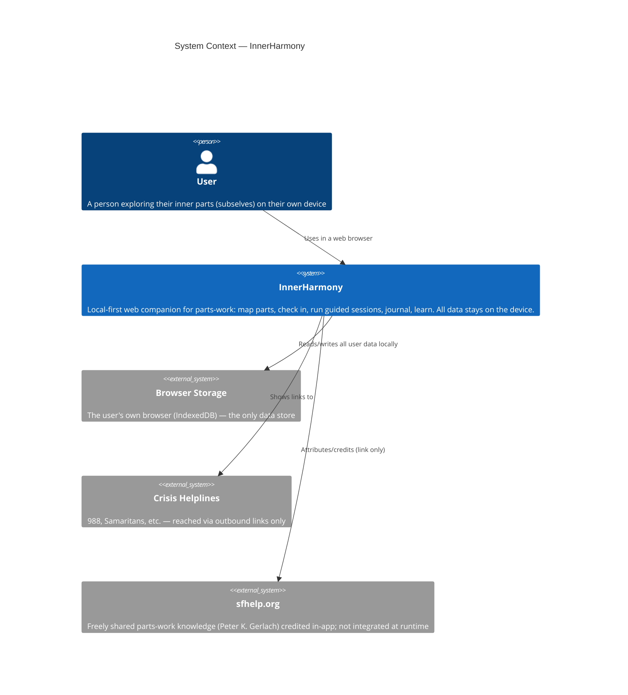
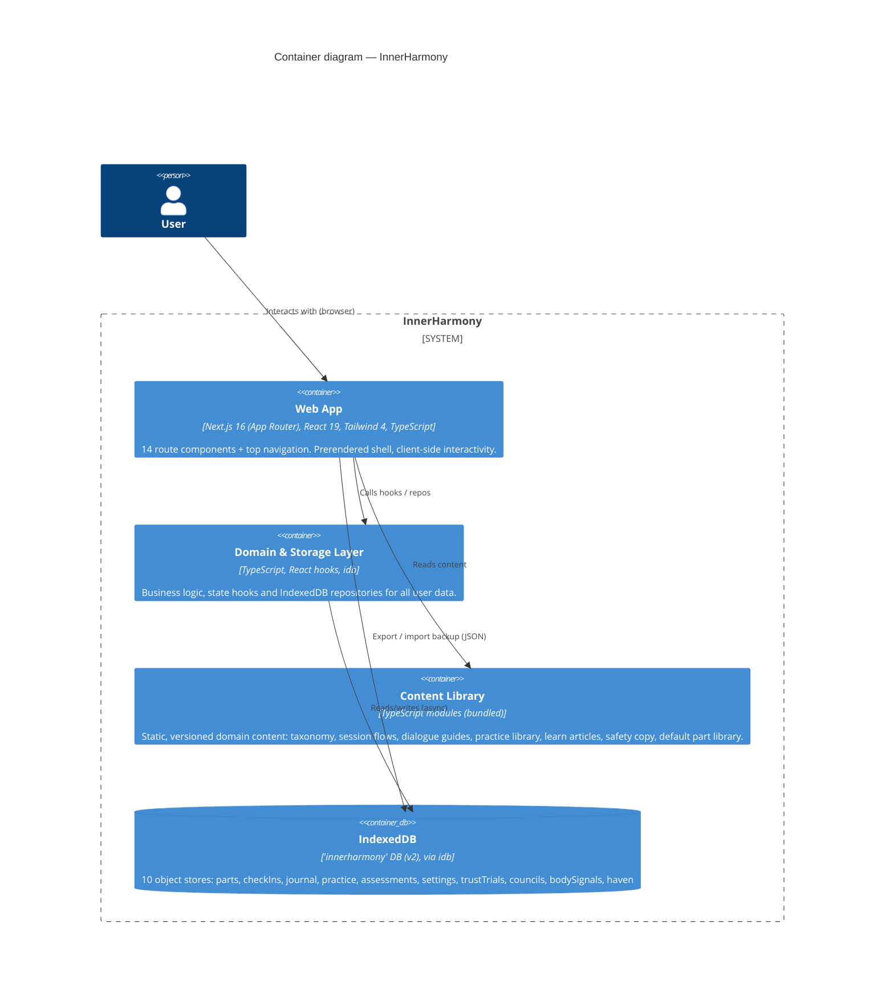
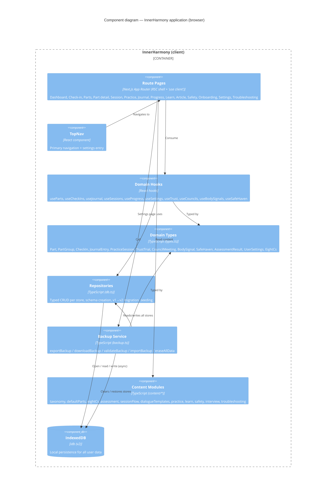
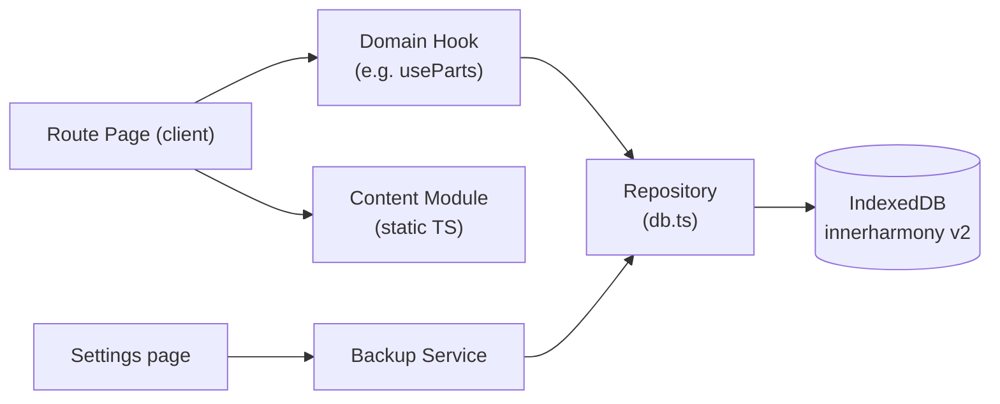

# InnerHarmony — C4 Architecture

> Parts-work self-exploration companion. **Local-first, no backend**: the entire
> application runs in the browser and persists to IndexedDB. There are no API
> routes, no server-side data stores, and no user accounts.

Diagrams use [Mermaid C4](https://mermaid.js.org/syntax/c4.html) and render on
GitHub, GitLab, and in VS Code (Markdown Preview Mermaid support).

---

## Level 1 — System Context

How InnerHarmony fits in the world around it.



**Authentication / authorization:** none. The device and its browser profile are
the security boundary.

---

## Level 2 — Container

What runs, and where.



**Deployment note:** the build prerenders pages (static + partial prerender);
there is no API or data tier to deploy. A simple static/Node host (or `next start`)
serves the shell and assets only — all logic and state live in the browser.

---

## Level 3 — Component

Zooming into the browser-side containers. This is the area with real structure.



### Data-flow (the one runtime path that matters)



---

## Key architectural characteristics

- **Local-first / privacy-preserving.** All personal data (parts, journal entries,
  check-ins, sessions) lives only in the user's browser IndexedDB. Nothing leaves
  the device; there is no server, account, or telemetry.
- **No backend, no API routes.** `find src -name route.ts` → none. The app is a
  prerendered React client application.
- **Separation of concerns.**
  - *Content* (`src/content/*`) — static, versioned, theory-derived text/data.
  - *Domain types* (`src/lib/types.ts`) — the frozen contract shared by content,
    hooks, and storage.
  - *Hooks* (`src/lib/hooks/*`) — state & business logic over repositories.
  - *Storage* (`src/lib/storage/*`) — IndexedDB schema, migrations, repositories,
    and backup/restore.
- **Portability / ownership of data.** The Backup Service exports every store to a
  versioned JSON envelope (`{ app, version, exportedAt, data }`) and validates
  before restoring, so users can back up and move their data without a server.
- **Offline-capable.** Because logic + data are client-side, the tool works
  without network connectivity once loaded.

## Deliberately absent

- No authentication, accounts, or multi-user support.
- No server-side database or sync.
- No third-party analytics or trackers.
- No clinical/therapy functionality (educational companion only, with crisis
  resources and a non-diagnostic disclaimer — see `src/content/safety.ts`).

---

### Alternative notation

If you prefer PlantUML (Structurizr/C4-PlantUML), the Level-2 container diagram
in C4-PlantUML would be:

```plantuml
@startuml
!include https://raw.githubusercontent.com/plantuml-stdlib/C4-PlantUML/master/C4_Container.puml

Person(user, "User")
System_Boundary(app, "InnerHarmony") {
  Container(webapp, "Web App", "Next.js 16 / React 19 / Tailwind 4", "14 route pages + top navigation")
  Container(domain, "Domain & Storage Layer", "TypeScript hooks + idb", "Logic, state, repositories")
  Container(content, "Content Library", "TypeScript modules", "Static domain content")
  ContainerDb(idb, "IndexedDB", "idb v2", "10 object stores")
}
Rel(user, webapp, "Uses")
Rel(webapp, domain, "Calls")
Rel(webapp, content, "Reads")
Rel(domain, idb, "Reads/writes")
@enduml
```
